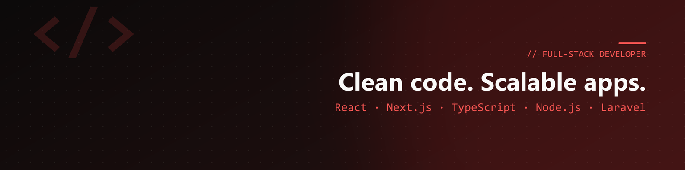

  

<h2 align="center">Hi, I'm George 👋</h2>

  Full-stack developer and designer building fast, reliable web and mobile products. 
  Tbilisi, Georgia (UTC+4) · Open to remote roles

  
  
  

  

---

### About me

- 💼 Full-Stack Developer at **re:soft**, building a pet-care e-commerce platform: catalog, checkout and payments
- 🛠️ Previously delivered 6+ websites and apps end to end for startups and small businesses
- 📱 Built a mobile app for a wearable personal-safety device and took it to a working prototype
- 🎨 Design and code are two sides of the same coin: I take products from Figma to production
- 🏛️ Studied law and worked as a junior architect before moving into code, so I care about structure and detail

Most of my work is client code in private repos. The best place to see it is my [portfolio](https://georgev.vercel.app).

---

### Tech stack

**Languages & frameworks**

**Data, cloud & tools**

**Design**

---

### Featured

| Project | What it is | Stack |
|---|---|---|
| [**portfolio-2026**](https://github.com/George-Vol/portfolio-2026) | My portfolio, with separate development and design branches, case studies as data and an interactive dot-grid background. [Live →](https://georgev.vercel.app) | Next.js 16 · React 19 · TypeScript · Tailwind CSS 4 |

---

  

<i>Have a product to build? Let's talk.</i>

