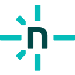

  

<h2 align="center">Hi, I'm George 👋</h2>

  Full-stack developer and designer building fast, reliable web and mobile products. 
  Good design and clean code are two sides of the same coin.

  

---

### 🛠️ What I do

- **Web apps:** full-stack products with React, Next.js and Laravel, from the database to the interface.
- **Mobile apps:** cross-platform iOS and Android apps with React Native and Expo.
- **Interface design:** clean, usable UIs designed in Figma and built to match, down to the pixel.
- **Integrations:** payments, authentication and third-party APIs wired into one smooth flow.

### 🧭 How I work

- I start with the data model and the user flow, then build the UI on top.
- I ship in small, reviewable pull requests with CI on every project.
- I use AI tools for speed, and review everything they write before it ships.
- I care about the details: loading states, empty states, edge cases and accessibility.

<!-- DESIGN WORK: add 4 images to assets/design/ and uncomment
### 🎨 Recent design work

  
  
  
  

-->

### 🧰 Tech stack

  &nbsp;&nbsp;
  &nbsp;&nbsp;
  &nbsp;&nbsp;
  &nbsp;&nbsp;
  &nbsp;&nbsp;
  &nbsp;&nbsp;
  &nbsp;&nbsp;
  

  <picture><source media="(prefers-color-scheme: dark)" srcset="assets/icons/nextjs-light.svg" /></picture>&nbsp;&nbsp;
  &nbsp;&nbsp;
  <picture><source media="(prefers-color-scheme: dark)" srcset="assets/icons/reactrouter-light.svg" /></picture>&nbsp;&nbsp;
  &nbsp;&nbsp;
  &nbsp;&nbsp;
  &nbsp;&nbsp;
  <picture><source media="(prefers-color-scheme: dark)" srcset="assets/icons/expo-light.svg" /></picture>&nbsp;&nbsp;
  

  <picture><source media="(prefers-color-scheme: dark)" srcset="assets/icons/express-light.svg" /></picture>&nbsp;&nbsp;
  &nbsp;&nbsp;
  &nbsp;&nbsp;
  <picture><source media="(prefers-color-scheme: dark)" srcset="assets/icons/prisma-light.svg" /></picture>&nbsp;&nbsp;
  &nbsp;&nbsp;
  &nbsp;&nbsp;
  &nbsp;&nbsp;
  

  &nbsp;&nbsp;
  &nbsp;&nbsp;
  &nbsp;&nbsp;
  <picture><source media="(prefers-color-scheme: dark)" srcset="assets/icons/amazonwebservices-light.svg" /></picture>&nbsp;&nbsp;
  <picture><source media="(prefers-color-scheme: dark)" srcset="assets/icons/vercel-light.svg" /></picture>&nbsp;&nbsp;
  &nbsp;&nbsp;
  &nbsp;&nbsp;
  

  &nbsp;&nbsp;
  &nbsp;&nbsp;
  &nbsp;&nbsp;
  &nbsp;&nbsp;
  &nbsp;&nbsp;
  &nbsp;&nbsp;
  &nbsp;&nbsp;
  

